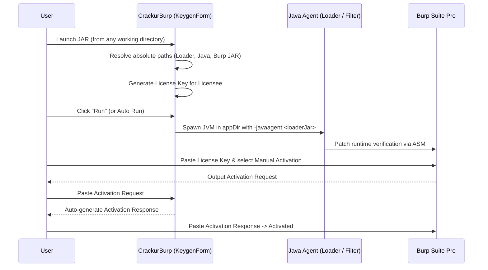

# CrackurBurp — Activation & Launcher Console v1.13

[](https://github.com/joelindra/CrackurBurp/releases)
[](https://adoptium.net/)
[](pom.xml)
[](https://portswigger.net/burp)
[](LICENSE)

A minimalist, precision-crafted **Burp Suite Professional Loader & Offline Activation Console**. Designed with a clean graphite interface, reliable cross-directory process launching, and seamless Java agent bytecode patching.

## How It Works



---

## Key Features

### Minimalist Precision UI
- **Graphite Split-Card Layout** — Clean sub-pixel `1px` hairline cards with dedicated header bars, subtle dividers, and flush monospace code surfaces powered by [FlatLaf](https://github.com/JFormDesigner/FlatLaf) and custom Java2D rendering.
- **Restrained Visual Hierarchy** — Calm neutral surfaces paired with subtle `6px` semantic status indicators (ready, update available, offline, or error) without harsh neon glare.
- **Instant Clipboard Feedback** — Dedicated **Copy**, **Paste**, and **Regenerate** controls with inline `Copied` confirmation.

### Reliable Cross-Directory Launcher
- **Absolute URI Path Resolution** — Resolves the loader JAR, `appDir`, Java executable, and newest `burpsuite_*.jar` via `Paths.get(codeSource.getLocation().toURI()).toAbsolutePath().normalize()`, preserving spaces and literal `+` characters.
- **Explicit Child Working Directory** — Launches Burp Suite via `ProcessBuilder` anchored to `appDir`, so running `java -jar C:\path\to\BurpLoaderKeygen.jar` from *any* shell directory works out of the box.
- **Non-Blocking Crash Diagnostics** — Redirects child JVM output to a temporary log (`crackurburp-launch-*.log`) and monitors exit codes on a background thread. If startup fails, a scrollable diagnostic dialog displays the exit code, log path, and output without freezing the UI.

### License & Automation Tools
- **Live Licensee Customization** — Edit the **Licensee** name at any time to regenerate a valid license key on the fly.
- **Reactive Offline Activation** — Pasting a manual activation request immediately computes the signed activation response.
- **Auto Run & Update Detection** — Checks PortSwigger releases asynchronously in the background and supports persistent **Auto Run** and **Ignore Update** settings stored in `.anonre.config.ini` alongside the JAR.
- **One-Click Start Scripts** — Generates `burp.bat` and a windowless `Burpsuite Professional.vbs` launcher directly inside the application directory.

---

## UI Overview

```text
┌──────────────────────────────────────────────────────────────────────────────┐
│ [⚡] CrackurBurp [v1.13] Activation & Launcher Console  [● Status] [Auto][Ign]│
├──────────────────────────────────────────────────────────────────────────────┤
│ ┌──────────────────────────────────────────────────────────────────────────┐ │
│ │ ["C:\...\java.exe" ... "-javaagent:...\loader.jar" ...]  [Copy] [▶ Run]  │ │
│ │ Licensee [ Licensed To Anonre       ]   ● burpsuite_pro_v2026.x · Ready  │ │
│ └──────────────────────────────────────────────────────────────────────────┘ │
│                                                                              │
│ ┌────────────────────────────────────┐  ┌──────────────────────────────────┐ │
│ │ License Key     [Regenerate][Copy] │  │ Activation Request [Paste][Copy] │ │
│ ├────────────────────────────────────┤  ├──────────────────────────────────┤ │
│ │ <auto-generated license key...>    │  │ <paste manual request here...>   │ │
│ └────────────────────────────────────┘  └──────────────────────────────────┘ │
│                                                                              │
│ ┌──────────────────────────────────────────────────────────────────────────┐ │
│ │ Activation Response                                               [Copy] │ │
│ ├──────────────────────────────────────────────────────────────────────────┤ │
│ │ <auto-generated activation response...>                                  │ │
│ └──────────────────────────────────────────────────────────────────────────┘ │
├──────────────────────────────────────────────────────────────────────────────┤
│ JDK 22.0.2 · Windows 11 · github.com/joelindra/CrackurBurp [Scripts] [Clear] │
└──────────────────────────────────────────────────────────────────────────────┘
```

---

## Quick Start

### Prerequisites
- **Java 17 or newer** (JDK 21 or JDK 22 recommended for latest Burp Suite releases)
- **Burp Suite Professional JAR** (named `burpsuite_*.jar`, placed in the same directory as the loader)

### Usage

1. **Place Files Together**  
   Put the loader JAR (e.g., `BurpLoaderKeygen.jar` or `burploader-new.jar`) in the same folder as your `burpsuite_pro_v2026.x.jar`.

2. **Start the Console**  
   Double-click the loader JAR or launch it from any terminal directory:
   ```powershell
   java -jar path\to\BurpLoaderKeygen.jar
   ```

3. **Launch & Activate Burp Suite**
   - *(Optional)* Customize the **Licensee** field — the **License Key** updates automatically.
   - Click **Run** to start Burp Suite Professional with the Java agent attached.
   - Copy the **License Key**, paste it into Burp Suite, and click **Next**.
   - Click **Manual activation** in Burp Suite and copy the request string.
   - Click **Paste** in the **Activation Request** card — the **Activation Response** is generated automatically.
   - Click **Copy** on **Activation Response**, paste it back into Burp Suite, and finish activation.

4. **Create Desktop / Silent Launchers *(Optional)***  
   Click **Create Scripts** in the footer to generate:
   - `burp.bat` — Direct batch launcher anchored to the Burp directory.
   - `Burpsuite Professional.vbs` — Silent launcher (runs without keeping a console window open).

---

## System Requirements

| Component | Requirement |
|-----------|-------------|
| **Java Runtime** | JDK 17, 21, or 22+ (64-bit) |
| **Operating System** | Windows 10/11, Linux, macOS |
| **Memory** | 4 GB RAM minimum recommended for Burp Suite |
| **Target File Naming** | `burpsuite_*.jar` in the same folder as the loader JAR |

---

## Troubleshooting

- **`Burp Suite JAR Not Found` dialog on Run**  
  Ensure your Burp JAR is in the same directory as the loader JAR and its filename starts with `burpsuite_` and ends with `.jar` (for example, `burpsuite_pro_v2026.10.1.jar`).
- **`Burp Suite Launch Failed (Exit Code ...)`**  
  Inspect the error output shown directly in the popup dialog or open the referenced `crackurburp-launch-*.log` file in your temp folder. Verify your installed Java version is 17 or newer (`java -version`).
- **Update badge shows `Offline`**  
  The console could not reach `portswigger.net` (e.g., offline environment or firewall). Offline launching and manual license activation continue to work normally.
- **Script creation fails**  
  Verify write permissions in the folder containing the loader JAR and ensure antivirus software is not blocking `.bat` or `.vbs` file creation.

---

## Changelog

### v1.13 (Current)
- **Fixed cross-directory silent launch failure (#3)**: Resolved loader, Java executable, and `burpsuite_*.jar` as normalized absolute paths via `toURI()`, preserving spaces and `+` characters without `URLDecoder`.
- **Added unified `ProcessBuilder` launch helper**: Sets `.directory(appDir.toFile())`, logs stdout/stderr to a temp file, and reports nonzero child JVM exits on the Swing EDT via a scrollable error dialog.
- **Anchored config & scripts to `appDir`**: `.anonre.config.ini`, `burp.bat`, and `Burpsuite Professional.vbs` now always resolve relative to the loader's directory.
- **Minimalist precision UI redesign**: Replaced heavy nested borders and neon accents with a clean graphite split-card architecture, pixel-centered controls, live **Licensee** input, and thread-safe EDT updates.

### v1.12
- Maven Shade build integration with FlatLaf dark theme.
- Automatic PortSwigger Pro release version check and Auto Run support.

### v1.2
- Added clipboard actions, startup script generator, and status indicators.

### v1.1
- Initial release with dark UI, license key generator, and offline activation request/response processor.

---

## License

Distributed under the MIT License. See `LICENSE` for details.

---

## Disclaimer

This project is provided strictly for **educational and security research purposes**.
- Use at your own risk; the author assumes no liability for misuse or damages.
- Burp Suite is a registered trademark of PortSwigger Ltd. This project is not affiliated with or endorsed by PortSwigger.

---

## Contact

**Author:** Anonre  
**GitHub:** [@joelindra](https://github.com/joelindra)
